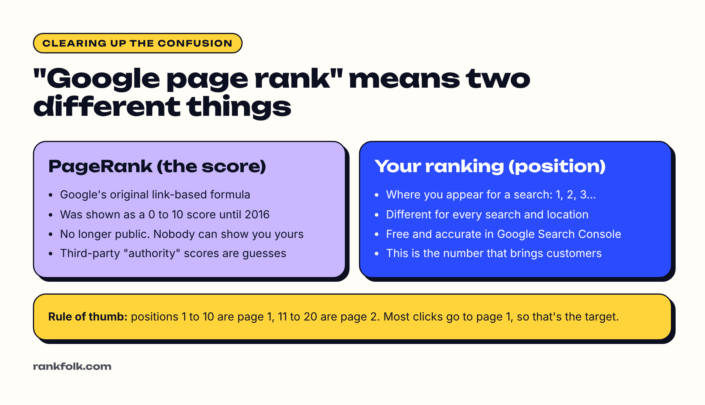

**You can't see your Google PageRank score any more. Google stopped showing it publicly in 2016.** What most people actually want to know when they search "what is my Google page rank" is **where their website ranks on Google**, meaning which position it appears in for a search. That you can check for free, accurately, in Google Search Console.

This guide clears up the confusion, then shows you how to find the number that matters.

## "Google page rank" means two different things

### 1. PageRank: Google's original link score

PageRank was the formula Google's founders used to judge how important a page is, based on how many links point to it and how important those linking pages are. For years Google showed a 0 to 10 PageRank score in its browser toolbar. Google removed that public score in 2016 ([Search Engine Land](https://searchengineland.com/google-has-confirmed-they-are-removing-toolbar-pagerank-244230)).

Google still uses link analysis, including PageRank, as part of how it ranks pages ([Google's guide to ranking systems](https://developers.google.com/search/docs/appearance/ranking-systems-guide)). But the score is internal. **No website or tool can show you your real PageRank.** Sites claiming to are showing either a third-party estimate or a guess.

### 2. Your ranking position

This is where your page appears for a particular search: position 1 is the top result, positions 1 to 10 are roughly page one, 11 to 20 page two, and so on. It changes for every search, and often by location and device.

This is the number that brings customers. If you're position 45 for "roof repair Leeds", hardly anyone will find you through that search, whatever any score says.

## How to find your Google ranking for free

### Method 1: Google Search Console (most accurate)

[Google Search Console](https://search.google.com/search-console/about) is free and uses real search data from Google.

1. Set it up for your website (our [Search Console setup guide](/blog/how-to-set-up-google-search-console/) shows how).
2. Open **Performance**, then **Search results**.
3. Tick **Average position** at the top.
4. Scroll to **Queries** to see each search you appeared for, with your average position for it.
5. Switch to **Pages** to see the average position of each page.

New sites can take a few days to show data. Look at the last 28 days or 3 months for a fair picture.

### Method 2: A clean manual search

Searching for yourself on your own phone is misleading, because Google personalizes and localizes results. If you want to check by hand, use a private or incognito window, signed out, and remember results still vary by location.

### Method 3: Check your Google Maps position

For local searches, your position in the map results matters more than the normal results. Search your main service plus your town in Google Maps and see where your profile appears. It will differ across your area, so check from a few locations if you can.

Our longer guide to [checking where your website ranks on Google](/blog/how-to-check-google-ranking/) covers each method in more depth, plus free rank-checking tools.

## What's a good Google ranking?

| Average position | What it means |
| --- | --- |
| 1 to 3 | Excellent. Most clicks for the search come here |
| 4 to 10 | Page one. You'll get some clicks, more as you climb |
| 11 to 20 | Page two. Close, but few people click this far |
| 21 to 50 | You're relevant, but need stronger content and links |
| 50+ | Google knows about you but doesn't trust the page for this search yet |

Two things to remember:

- **Average position is an average** across many searches, so one great search can be hidden by lots of weak ones. Always check individual queries.
- **A new website usually starts low.** It's normal for brand-new pages to sit at position 50 to 90 for a while before climbing. Read [how long SEO takes](/blog/how-long-does-seo-take/) for realistic timelines.

## How to improve your Google ranking

Since you can't see PageRank, focus on the things that move your position:

1. **Match the search.** Each page should answer one clear question or cover one service, with the words people actually search in the title and first paragraph.
2. **Be the most useful result.** Compare your page with the top three results and fill the gaps: missing steps, prices, photos, FAQs.
3. **Earn links.** Links from other relevant, trustworthy sites are still a strong signal. Local directories, suppliers, trade associations and local news are realistic starting points for small businesses.
4. **Link your own pages together** so Google can see which pages matter most.
5. **Fix technical basics:** fast loading, works on phones, pages can be indexed. Our [free website audit](/tools/website-audit/) checks the most common problems.
6. **For local searches,** strengthen your Google Business Profile. See [how to get your business on the first page of Google](/blog/how-to-get-my-business-on-the-first-page-of-google/).

## Frequently asked questions

### Can I still check my PageRank?

No. Google stopped publishing PageRank scores in 2016. Tools that show "page rank" or "domain authority" scores use their own formulas, which can be useful for comparison but aren't Google's numbers.

### Is PageRank still used by Google?

Yes. Google lists PageRank among its link analysis systems in its guide to ranking systems, but it's one of many signals and it's not visible to site owners.

### Why is my ranking different every time I search?

Google personalizes results by location, device and search history, and rankings change daily. That's why Search Console's average position is a better guide than checking by hand.

### How do I get to page one of Google?

Pick specific searches you can realistically win (often longer, local searches), make the best page for each one, earn a few good links, and give it time. Our guide to [getting on the first page of Google](/blog/how-to-get-my-business-on-the-first-page-of-google/) goes step by step.

## Summary

- The public PageRank score is gone. Nobody can show you your real one.
- What matters is your **ranking position** for the searches your customers use
- Check it free in **Google Search Console** under Performance, with Average position ticked
- Positions 1 to 10 are page one; most clicks go to the top three
- Improve it with useful, focused pages, good links, internal links and a strong Google Business Profile
