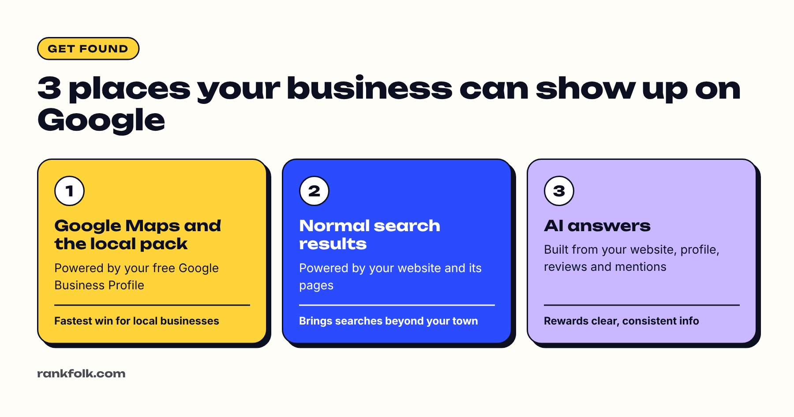

To get your business on Google for free, **create and verify a Google Business Profile** so you appear on Google Maps and in local results, then **make sure your website can be found** by setting up Google Search Console. Those two steps cover almost every way customers find a small business on Google, and neither costs anything.

Here's the whole process, in order, with links to detailed guides for each part.

## The 3 places your business can appear on Google

1. **Google Maps and the local pack:** the map and list of businesses for searches like "dentist near me". Powered by your **Google Business Profile**.
2. **Normal search results:** the list of websites below. Powered by **your website**.
3. **AI answers:** AI Overviews and AI Mode in Google Search, which draw on websites and other information Google has. Google says the same SEO basics apply ([Google Search Central](https://developers.google.com/search/docs/appearance/ai-features)).

For most local businesses, the Business Profile brings results fastest, so start there.

## Step 1: Check if your business is already on Google

Google sometimes creates a listing automatically from public information, or a previous owner may have made one.

1. Search Google Maps for your exact business name and town.
2. If a listing appears, open it and look for **Own this business?** or **Claim this business**.
3. If it's already managed by someone else, use **Request access**. Don't create a second listing; duplicates cause problems with verification and ranking.

## Step 2: Create your Google Business Profile

If there's no listing:

1. Go to [Google Business Profile](https://www.google.com/business/) and sign in with a Google Account you control (ideally one tied to a business email you'll keep).
2. Enter your **business name** exactly as it appears in real life. No extra keywords.
3. Pick your **primary category**, the one that best describes your main service.
4. Choose whether customers visit your location, or you visit them (a **service-area business**), or both.
5. Add your **phone number** and **website**.

Our [Google Business Profile setup guide](/blog/how-to-set-up-google-business-profile/) covers every screen in detail. If you work from home, see [how to set up a profile without showing your address](/blog/google-business-profile-without-address/).

## Step 3: Verify your business

Google needs to confirm you're the real owner before your profile shows fully and you can manage reviews. Depending on your business, Google may offer phone or text, email, a recorded video, a live video call or a postcard. You can't choose; Google decides.

- Most businesses now verify by video. Our guide to [video verification](/blog/google-business-profile-video-verification/) shows exactly what to film.
- If the postcard is the only option, read [how to verify without a postcard](/blog/verify-google-business-profile-without-postcard/).

## Step 4: Complete every section of your profile

A half-empty profile loses to a complete one. Add:

- **Hours,** including holiday hours
- **Services,** with short descriptions
- **Service areas,** if you travel to customers
- **A description** in plain English: what you do, for whom, where
- **Photos:** your work, your team, your premises or vehicles, your logo and a cover photo
- **Booking or quote links,** if you use them

## Step 5: Start getting reviews

Reviews help you rank and persuade people to call. Ask every happy customer, make it easy with a direct link or QR code, and reply to every review, good or bad. Our free [review request generator](/tools/review-request-generator/) writes the message for you, and our guide to [responding to negative reviews](/blog/how-to-respond-to-negative-google-reviews/) helps with the tricky ones.

## Step 6: Get your website into Google search results

If you have a website:

1. Set up [Google Search Console](https://search.google.com/search-console/about) and verify you own the site. Our [Search Console setup guide](/blog/how-to-set-up-google-search-console/) walks you through it.
2. **Submit your sitemap** so Google can find all your pages.
3. Use **URL Inspection** on your homepage and select **Request indexing**.
4. Give each page a clear title that says what it's about and where, like "Emergency Plumber in Leeds | Smith Plumbing".

If you don't have a website yet, our guide on [how to make a business website](/blog/how-to-make-a-website-for-my-small-business/) covers it step by step. A profile without a website can still get calls, but a website lets you show up for far more searches.

If your site still doesn't appear after a few weeks, see [why your website isn't showing up on Google](/blog/why-is-my-website-not-showing-up-on-google/).

## Step 7: Make your details consistent everywhere

Use the exact same business name, address and phone number on:

- Your Google Business Profile
- Your website (usually in the footer and contact page)
- Facebook, Instagram and other social profiles
- Directories such as Apple Maps, Bing Places, Yelp and trade directories

Consistent details help Google trust that your information is correct.

## Step 8: Help AI answers understand your business

AI answers in Google and other assistants draw on what's written about you online. You can't pay to appear, but you can make your information clear:

- Say plainly on your website what you do, where and for whom
- Keep your Google Business Profile complete and up to date
- Collect reviews that mention the service and area
- Get mentioned on other trustworthy sites

Our guide to [getting your business recommended by ChatGPT](/blog/how-to-get-your-business-recommended-by-chatgpt/) goes deeper.

## How long until your business shows up?

- **Your Business Profile** can appear for searches of your business name soon after verification.
- **A new website** is often indexed within days to weeks once you submit it in Search Console.
- **Ranking for general searches** like "roofer near me" usually takes longer and depends on your competition. See [how long SEO takes](/blog/how-long-does-seo-take/).

Want to see how visible you are right now? Our free [Google Visibility Scorecard](/tools/google-visibility-scorecard/) takes two minutes and shows what to fix first.

## Frequently asked questions

### Is it free to put my business on Google?

Yes. Creating a Google Business Profile, verifying it and setting up Search Console are all free. Google Ads and Local Services Ads are optional paid extras.

### Can I put my business on Google without a website?

Yes. A Google Business Profile works without a website, and many small businesses get calls from it alone. A website helps you show up for more searches and gives customers more reason to trust you.

### Can I list a home-based business on Google?

Yes. Set it up as a service-area business, verify with your home address, then hide the address so only your service areas show.

### Why can't I find my business on Google after creating it?

It may not be verified yet, it may be under review, or you may be searching too broadly. Search your exact business name first. If it still doesn't show, our guide to [why your business isn't showing on Google Maps](/blog/business-not-showing-on-google-maps/) covers the common causes.

## Checklist

- [ ] Searched Maps for an existing listing and claimed it if found
- [ ] Created a Google Business Profile with your real name and the right category
- [ ] Verified it
- [ ] Filled in hours, services, areas, description and photos
- [ ] Asked your first customers for reviews
- [ ] Set up Google Search Console and submitted your sitemap
- [ ] Matched your name, address and phone number everywhere
