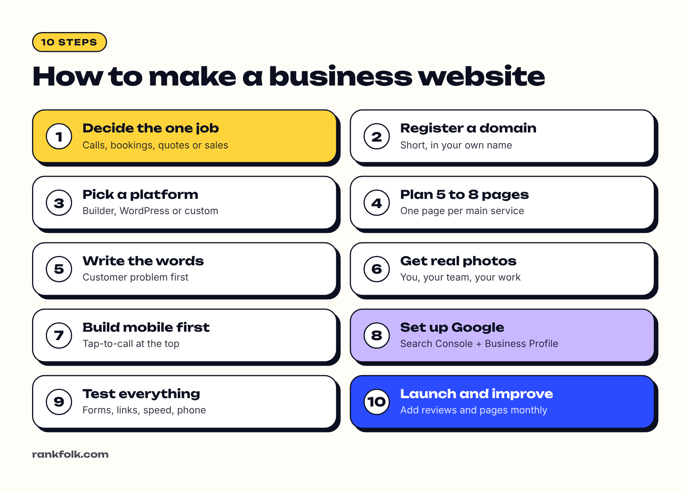
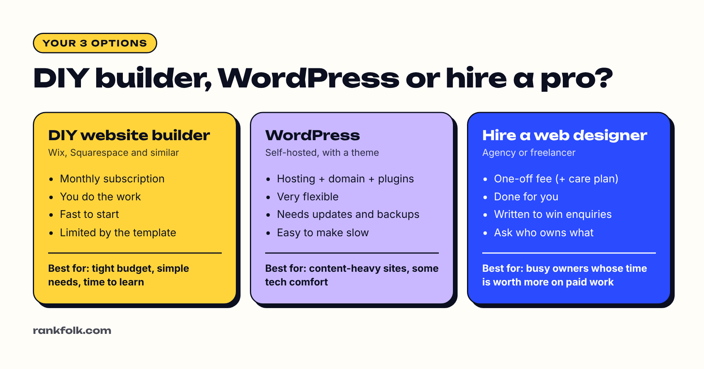
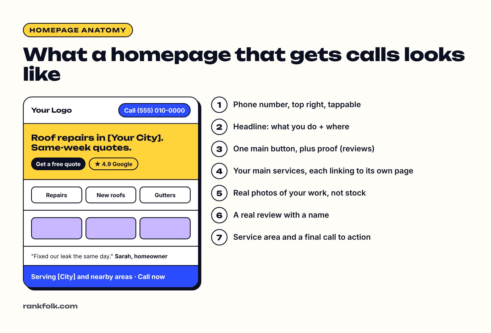

To make a website for your small business, you need five things: **a domain name, a platform to build on, a short plan of pages, words and photos that explain what you do, and a few setup steps so Google can find you.** You can do it yourself with a website builder in a weekend, or hire someone to do it for you.

I build websites for small businesses and contractors for a living, and the same pattern shows up again and again: the sites that bring in calls are rarely the fanciest. They're the ones that say clearly what the business does, where, and how to get in touch. This guide walks through the whole process in plain English, in the order I'd do it. Even if you plan to hire a designer, reading it will help you brief them properly and avoid paying for things you don't need.

## Before you start: what you'll need

Have these ready and the build itself goes much faster:

- **Your business details:** exact business name, phone number, email, address or service area, opening hours
- **A list of your services,** in the words your customers use
- **10 to 30 real photos** of your work, your team and your premises or vehicles
- **3 to 5 customer reviews** you can quote (with permission), or a link to your Google reviews
- **Your logo,** if you have one
- **A budget** for the domain and platform (see the cost section below)
- **Log-ins** for your email and your Google Business Profile, if you have one

## Step 1: Decide what your website needs to do

Before you pick colors or templates, answer three questions:

1. **Who is it for?** Local homeowners? Other businesses? Tourists?
2. **What should visitors do?** Call you, book online, request a quote, buy something, visit your shop?
3. **What do they need to know first?** Usually: what you do, where, roughly how much, and why they should trust you.

Write the answers down. Every decision after this should support that one main action. For most service businesses, that action is **a phone call or a quote request**, so the site should make both effortless from every page.

## Step 2: Choose and register a domain name

Your domain is your web address, like yourbusiness.com. Tips:

- Keep it short, easy to spell and easy to say out loud on the phone.
- Use your business name if it's available. If not, add your town or trade (for example, smithroofingleeds.co.uk).
- Pick the extension your customers expect: .com is common in the US; many businesses in other countries use their local version, such as .co.uk, .ca, .com.au or .co.nz.
- Avoid hyphens and numbers. They're easy to get wrong when said out loud.
- **Register it in your own name, with your own email.** I regularly meet owners whose domain was registered by a former designer and who can't get it back. Don't let that be you.
- Turn on **auto-renew** so it never expires by accident.

You can buy a domain from a registrar (Cloudflare, Namecheap, GoDaddy and others) or through your website builder. Buying it separately makes it easier to switch platforms later.

## Step 3: Pick a platform

| Platform type | Examples | Good for | Watch out for |
| --- | --- | --- | --- |
| Website builder | Wix, Squarespace | DIY, simple sites, little technical knowledge | Monthly fees forever; harder to move away |
| WordPress | WordPress.org with hosting | Flexibility, blogs, lots of plugins | Needs updates, backups and security care |
| Ecommerce platform | Shopify | Selling products online | Transaction and app fees add up |
| Custom built | Built by a developer or agency | Speed, unique design, specific features | Make sure you own the code and accounts |

For most small service businesses, any mainstream option can work well. **The content matters more than the platform.** If you're unsure, our [Wix vs Squarespace vs WordPress comparison](/blog/wix-vs-squarespace-vs-wordpress/) goes into detail.

A simple way to decide:

- **Under 10 pages, no online sales, and you want to do it yourself:** a website builder.
- **You plan to publish lots of articles, or need special plugins:** WordPress.
- **You sell physical products:** Shopify or your builder's ecommerce plan.
- **You'd rather spend your time on paid work:** hire someone (see "DIY or hire someone?" below).

## Step 4: Plan your pages

Most small business websites need only **5 to 8 pages**:

- **Home:** what you do, where, and your main call to action
- **Services:** ideally **one page for each main service** (more on why below)
- **About:** who you are, with real photos
- **Reviews or testimonials**
- **Contact:** phone, email, form, address or service area, hours

Add a **gallery** or **projects** page if your work is visual, and an **FAQ** if customers ask the same questions. See [what pages a small business website should have](/blog/what-pages-should-a-small-business-website-have/) for the full breakdown.

### Why one page per service matters

Google matches pages to searches. A single "Services" page listing ten things rarely ranks for any of them. A dedicated page for "Gutter repair in Leeds" has a real chance of showing up when someone searches exactly that. It also gives you space to answer the questions people ask before they call: how long it takes, what affects the price, what's included.

If you serve several towns, mention them naturally on your service and contact pages. Avoid copying the same page and only swapping the town name; Google treats that as low quality.

## Step 5: Design the homepage around one action

Visitors decide within seconds whether they're in the right place. On the homepage, the first screen (before anyone scrolls) should show:

1. **Your phone number,** top right, tappable on phones
2. **A headline that says what you do and where,** such as "Roof repairs in Leeds. Same-week quotes." Not "Welcome to our website".
3. **One main button** (Call now, Get a quote, Book online) plus a trust signal such as your Google rating

Below that: your main services linking to their own pages, real photos of your work, a review with a name, your service area and a final call to action. That's it. Sliders, auto-playing videos and long company histories usually get in the way.

## Step 6: Write your content

This is the step most people rush, and it's the one that matters most. Tips:

- **Lead with the customer's problem,** not your history. "Blocked drain? We can usually be there today" beats "Established in 1998".
- **Be specific.** "We install and repair split system air conditioners across Brisbane's northern suburbs" is better than "We offer quality HVAC solutions".
- **Use the words customers use.** If they say "boiler", don't only say "heating system". Search Console (Step 9) will later show you the exact words they type.
- **Keep paragraphs short.** People skim, especially on phones.
- **Answer common questions** right on the page: price ranges, how long jobs take, whether you're licensed and insured, which areas you cover.
- **Show proof:** reviews, years in business, licences, guarantees, photos of finished jobs.
- **End every page with a clear next step**: call, book or request a quote.

AI writing tools can help you get a first draft down, but read every line and add the details only you know: your areas, your process, real examples. Generic text is easy to spot, for customers and for Google.

## Step 7: Get real photos

Real photos of you, your team, your premises and your work build far more trust than stock images. A modern phone in good daylight is usually enough. Shoot:

- You and your team, smiling and natural
- Your work: before and after shots are especially convincing
- Your premises, vehicles and equipment

Before uploading, **shrink large photos** (most phone photos are far bigger than a website needs) and give each file a descriptive name, like `kitchen-renovation-leeds.jpg` rather than `IMG_4032.jpg`. Add short alt text describing each image; it helps visually impaired visitors and Google.

## Step 8: Build it, mobile first

Most visitors will see your site on a phone. As you build:

- Put your phone number at the top, as a **tap-to-call link** (not just text, and not a button that copies the number)
- Keep buttons large and easy to tap
- Keep forms short: name, phone, a message, maybe a photo upload. Every extra field loses enquiries.
- Avoid pop-ups that cover the screen
- Check every page on your own phone before launch

**Speed matters too.** A slow site loses visitors before they see anything. Heavy images, too many plugins and auto-playing video are the usual causes. Our guide on [how to make your website faster](/blog/how-to-make-my-website-faster/) covers the fixes.

## Step 9: Set up the basics for Google

Before or right after launch:

- **Page titles:** give each page a clear, unique title, such as "Emergency Electrician in Leeds | Bright Spark".
- **Meta descriptions:** a one-line summary for each page that may show in Google results. Check both with our [Google search preview tool](/tools/google-search-preview/).
- **Google Search Console:** set it up and submit your sitemap. Our [Search Console setup guide](/blog/how-to-set-up-google-search-console/) shows you how.
- **Google Business Profile:** create or claim it, then add your new website link. For local businesses this is often the biggest source of calls. See our [Google Business Profile setup guide](/blog/how-to-set-up-google-business-profile/).
- **Consistent details:** use the exact same business name, address and phone number on your site, your Google profile and any directories.
- **Analytics:** add Google Analytics or a simpler alternative so you can see visits.

Google's own [SEO Starter Guide](https://developers.google.com/search/docs/fundamentals/seo-starter-guide) is a good free reference for these basics. Don't expect to show up for competitive searches straight away; a brand-new site usually takes months to build trust with Google. Our guide on [how long SEO takes](/blog/how-long-does-seo-take/) explains why.

## Step 10: Test, launch and keep improving

Run through this list before you tell anyone about the site:

- [ ] Every page works on a phone
- [ ] Phone number dials when tapped
- [ ] Contact form sends to the right email (test it!)
- [ ] No placeholder text left ("Lorem ipsum")
- [ ] All links and buttons work
- [ ] Spelling and contact details checked by someone else
- [ ] Site loads quickly (test with [PageSpeed Insights](https://pagespeed.web.dev/))
- [ ] Padlock (https) shows in the browser
- [ ] Privacy policy page added (needed if you collect any personal details, and in the UK and EU when you use cookies or analytics)

You can also run your homepage through our [free website audit tool](/tools/website-audit/) to catch common problems.

A website is never really finished. After launch:

- Add new project photos and reviews regularly
- Improve pages that get visits but few enquiries
- Add pages for services people ask about
- Check Search Console monthly to see what people search for

## How much does a small business website cost?

Costs depend on which route you choose. The main pieces are:

| Cost | DIY builder | WordPress | Hiring someone |
| --- | --- | --- | --- |
| Domain name | Yearly fee | Yearly fee | Yearly fee (keep it in your name) |
| Platform or hosting | Monthly plan, usually cheaper when paid yearly | Hosting plan, plus paid themes or plugins if needed | Often included in a care plan, or paid by you |
| Design and build | Your time | Your time, or a developer | One-off fee |
| Ongoing | Plan renewal | Updates, backups, security | Optional monthly care plan |

Builder prices change often, so check the official pricing pages for [Wix](https://www.wix.com/plans) and [Squarespace](https://www.squarespace.com/pricing) before you commit, and look at the **renewal** price, not just the first-year discount. To see what your own site involves, try our free [website cost planner](/tools/website-cost-planner/), which also writes a brief you can send for quotes. For what drives the price up, read our full guide to [how much a small business website costs](/blog/how-much-does-a-small-business-website-cost/).

## DIY or hire someone?

**Do it yourself if:** your budget is very tight, your needs are simple and you enjoy learning new tools. Set aside a few days, most of it for writing.

**Hire someone if:** your time is worth more on paid work, you want a professional result quickly, or you need features like bookings, quote tools or online sales.

If you hire, ask these questions before you pay:

1. **Who will own the domain, the website and the accounts?** The answer should be you.
2. **Do you write the content, or do I?** Many quotes assume you supply all text and photos.
3. **What happens after launch?** Who fixes things, and what does it cost?
4. **Can I see sites you've built for businesses like mine,** and do they load fast on a phone?
5. **Will the site be set up for Google?** Titles, Search Console, sitemap and Google Business Profile link.

## Common mistakes to avoid

- **Letting someone else own your domain** or website accounts
- **A homepage that doesn't say what you do or where** in the first screen
- **Phone number hidden** in the footer or not tappable
- **Stock photos** of people who don't work for you
- **One "Services" page** for everything instead of a page per main service
- **No reviews** anywhere on the site
- **A beautiful site nobody can find** because Search Console and the Google Business Profile were never set up
- **Launching and forgetting it:** outdated prices, old photos and expired offers put people off

## Frequently asked questions

### Can I make a business website for free?

Many website builders offer free plans, but they usually show the builder's branding and don't let you use your own domain name. For a business, a paid plan with your own domain looks far more professional and builds more trust.

### How long does it take to make a small business website?

Using a builder, a simple site can be put together in a few days if your words and photos are ready. Writing good content usually takes longer than the building itself, so start there. A designer-built site commonly takes a few weeks, mostly waiting on content and feedback.

### Do I need to know how to code?

No. Website builders and WordPress page builders let you create a professional site without code. Coding skills only become necessary for custom features or highly customized designs.

### What's the most important page on a small business website?

For most service businesses, the service pages, because that's where people decide whether you can solve their problem. The homepage gets them in the door; service pages win the enquiry.

### Do I still need a website if I have a Google Business Profile?

A Google Business Profile is essential for local searches, but a website gives you space to explain your services, show your work and rank for searches beyond your immediate area. The two work best together. Our guide [does a small business need a website?](/blog/does-a-small-business-need-a-website/) looks at this in more depth.

### Why isn't my new website showing on Google?

New sites can take days or weeks to be indexed, and longer to rank. Submit your sitemap in Search Console, then see our guide to [why your website isn't showing up on Google](/blog/why-is-my-website-not-showing-up-on-google/).

## Summary

1. Decide the main action you want visitors to take
2. Register a short domain in your own name
3. Choose a platform that fits your skills and needs
4. Plan 5 to 8 focused pages, with one page per main service
5. Design the homepage around one clear action
6. Write clearly, for customers, with real photos
7. Build for phones first and keep it fast
8. Set up page titles, Search Console and your Google Business Profile
9. Test everything, launch and keep improving

A simple website with clear words and real photos will beat a fancy one that doesn't explain what you do.
