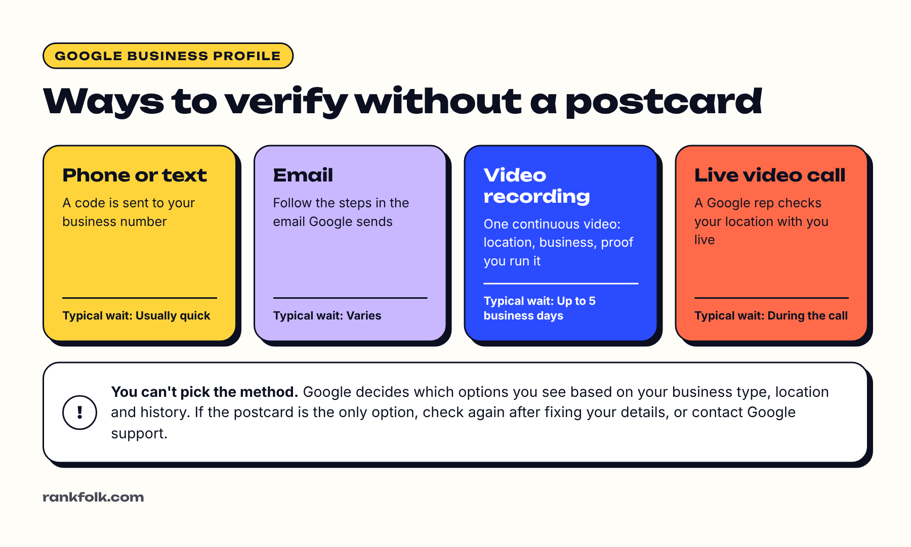

Yes, you can verify your Google Business Profile (formerly Google My Business) without a postcard. **Most businesses are now offered phone, text, email, a recorded video or a live video call instead.** You can't choose which methods you get: Google picks them based on your business type, location and the information on your profile ([Google's verification help](https://support.google.com/business/answer/7107242)).

So the real question is: what can you do to get a faster method offered, and what should you do if the postcard is the only option on screen? This guide covers both.

## Why people want to skip the postcard

The postcard was Google's standard method for years. It has real downsides:

- It can take up to 14 days to arrive, and sometimes never does
- The code expires after 30 days
- Editing your profile while you wait can invalidate the code
- It's useless for businesses whose mail goes to a different place than where they work

Google has been offering postcards less and less, and showing video verification to more businesses instead. Many owners searching for "verify without postcard" are working from older guides written when the postcard was the default.

## The methods you may see instead

| Method | What you do | Typical wait |
| --- | --- | --- |
| **Phone call or text** | Google sends a code to your business phone number; you type it in | Usually quick |
| **Email** | Follow the steps in an email Google sends to the address shown | Varies |
| **Video recording** | Record one continuous video showing your location, business and proof you run it | Review can take up to 5 business days |
| **Live video call** | A Google support rep checks your location with you on a call | Decided during the call |
| Postcard | Google mails a 5-digit code to your address | Usually within 14 days |

Some businesses are asked to complete **more than one** method. That's normal, especially for new profiles or businesses in categories Google checks more closely.

## How to see which methods you're offered

1. Sign in to the Google Account that manages the profile.
2. Search Google for your exact business name, or open **Google Maps** and go to your profile.
3. Select **Get verified** (or **Verify now**).
4. Google shows the available methods. If more than one appears, you can pick between those.

If you're managing several profiles, you'll find them all in [Business Profile Manager](https://business.google.com/).

## How to get offered a method other than the postcard

You can't request a specific method, but these steps remove the most common reasons Google falls back to slower checks:

### 1. Fix your profile details first

Before you press **Get verified**, check:

- **Business name:** your real-world name only. No added keywords or towns ("Smith Plumbing" not "Smith Plumbing Best Emergency Plumber Leeds").
- **Address:** complete, including suite or unit number, and matching what's on your signage and bills.
- **Phone number:** a direct line that can receive calls or texts. Automated phone menus can't receive codes.
- **Category:** the one that best describes your main service.
- **Website:** a working site on your own domain with the same name, address and phone number helps.

Inconsistent or unusual details are a common reason for extra checks.

### 2. Use the phone you'll verify on

Video verification is recorded live in the Google Maps or Google app on a phone. If you start on a computer, Google usually shows a QR code to continue on your phone. Make sure location access is turned on.

### 3. Don't create duplicates

If your business already has a profile (perhaps created by a previous owner or automatically), **request ownership** of that one instead of creating a new profile. Duplicates often trigger extra verification.

### 4. Wait, then check again

The methods on offer aren't fixed. If you've just created or edited the profile, it's common for the options to change after Google has processed the information.

## How to pass video verification first time

Video is the method most businesses now see, and it's where most failures happen. Google's [video verification guide](https://support.google.com/business/answer/14271705) sets these rules:

- **One continuous, unedited video,** recorded live in the app
- **At least 30 seconds** long
- Show **your location** (street sign, building number, nearby businesses or landmarks)
- Show **your business** (permanent signage matching your profile name, or for service-area businesses, your tools, equipment or branded vehicle)
- Show **proof you manage it** (unlocking the door or van, opening the till, entering a staff-only area, or showing a business document that matches your profile name)
- **Don't show** sensitive information or other people's faces

Plan the route before you press record. Our full walkthrough of [how to verify your Google Business Profile with video](/blog/google-business-profile-video-verification/) covers what to film for storefront and service-area businesses, step by step.

### Service-area businesses (no storefront)

If you work from home or travel to customers, you can still verify by video. Show your street or neighborhood, then your tools, branded vehicle or uniform, then proof of management such as unlocking your van or showing an invoice with your business name. After verifying, **hide your address** and set your service areas. See [Google Business Profile without an address](/blog/google-business-profile-without-address/) for the settings.

## What if the postcard is the only option?

If you only see the postcard:

1. **Double-check your details** using the list above, then try **Get verified** again a day or two later.
2. **If you must use the postcard,** request it once and then don't edit your name, address or category, and don't request another code until the first has arrived or 14 days have passed.
3. **If it never arrives,** request a new one after the waiting period, or contact support.

## What if you see "no more ways to verify" or verification fails?

- **Verification failed:** Google shows the reasons. Select **Review issues**, fix them, and try again. For video, record a new video that includes everything from the first one plus what was missing.
- **No methods available, or you've run out of attempts:** contact [Google Business Profile support](https://support.google.com/business/gethelp). Have photos of your signage, a recent utility bill or business document with your name and address, and your website ready.
- **Someone else already verified it:** use **Request access** on the profile. If the current owner doesn't respond, Google's email usually explains how to continue.

## Things that won't work

- **Virtual offices, mailboxes and PO boxes.** Google doesn't allow them as business addresses, and video verification will fail because you can't show real operations there.
- **Paying someone to "verify for you"** using their address or a fake video. This breaks Google's rules and can get the profile suspended. If that's already happened, see our guide to a [suspended Google Business Profile](/blog/google-business-profile-suspended/).
- **Pre-recorded or edited videos.** They must be recorded live, in one take.

## Frequently asked questions

### Can I choose to verify my Google business by phone?

No. You can only choose between the methods Google shows you. If phone or text appears in the list, pick it: it's usually the quickest.

### How long does verification without a postcard take?

Phone, text and email can be immediate. Video recordings are reviewed, which Google says can take up to 5 business days. Live video calls are decided during the call.

### Why does Google ask me to verify again?

Google may re-verify a profile after major edits (name, address or category), a change of owner, or if it spots signs of a problem. Use the same steps: keep details accurate and choose the quickest method offered.

### Is the postcard method gone completely?

No, but it's offered to fewer businesses than it used to be. Google's own help page describes the postcard as not available for all businesses, and many owners now only see video or phone options.

## Quick checklist

- [ ] Business name, address, phone and category are accurate and match your signage
- [ ] You're signed in to the right Google Account on your phone
- [ ] You checked for an existing or duplicate profile first
- [ ] For video: one continuous take showing location, business and proof of management
- [ ] You didn't edit the profile while waiting for a decision
- [ ] After verifying: fill in every section and start [setting up your profile properly](/blog/how-to-set-up-google-business-profile/)
