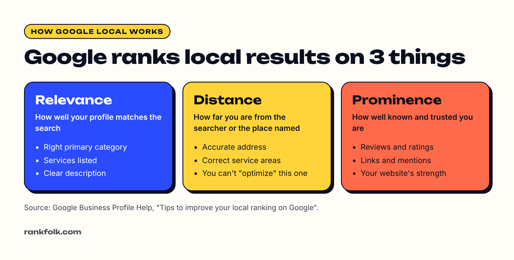

**"Google Local" is the name people use for Google's local search results: the map and list of nearby businesses that appear when someone searches for something like "plumber near me" or "coffee in Leeds".** Those results come from free **Google Business Profiles**, sometimes with paid **Local Services Ads** above them. Google Local was also the name of an old Google product, which has since been folded into Google Maps and Google Business Profile.

If you run a local business, these results are often where your phone calls come from. This guide explains what's in them, how Google decides who shows up, and what you can do to appear.

## What "Google Local" includes today

There's no single product called Google Local any more. When people use the term, they usually mean one of these:

| What you see | What it is | Free or paid? |
| --- | --- | --- |
| **The local pack** | The map with three businesses under it, shown in normal Google search results | Free |
| **Google Maps results** | The full list of businesses when you search in Maps | Free |
| **Your Business Profile** | The panel showing your hours, reviews, photos and call button | Free |
| **Local Services Ads** | Ads at the very top for service searches, often with a "Google Guaranteed" or "Google Screened" badge | Paid per lead |
| **Local search ads** | Normal Google Ads shown in Maps and local results | Paid per click |

So if you've heard "you need to be on Google Local", it almost always means **you need a complete, verified Google Business Profile**. That's the free part, and it's where most businesses should start.

## How Google decides who shows up locally

Google says local results are based mainly on three things ([Google Business Profile Help](https://support.google.com/business/answer/7091)):

1. **Relevance:** how well your profile matches what the person searched. Your categories, services and description all feed this.
2. **Distance:** how far your business is from the searcher, or from the place named in the search. You can't change this, beyond making sure your address and service areas are accurate.
3. **Prominence:** how well known your business is. Google says this is based on information from across the web, including links, articles and directories, and that **review count and rating** play a part. Your website's position in normal search results also counts.

Google also states that you **can't pay** to rank higher in the free local results. Ads are shown separately and labelled as sponsored.

## How to show up in Google Local results

### 1. Create and verify your Google Business Profile

Everything starts here. Our step-by-step [Google Business Profile setup guide](/blog/how-to-set-up-google-business-profile/) walks you through it, and our guide to [verifying without a postcard](/blog/verify-google-business-profile-without-postcard/) helps if verification gets stuck.

### 2. Choose the right primary category

Your primary category is one of the strongest relevance signals. Pick the one that describes your **main** service ("Roofing contractor", not "Contractor"), then add a few secondary categories for other services you really offer.

### 3. Fill in every section

Add your services, hours, service areas, description, website and photos. A complete profile gives Google more to match against searches, and gives customers more reasons to call.

### 4. Get reviews, steadily

Ask every happy customer. A steady flow of genuine reviews beats a burst followed by nothing. Our [review request generator](/tools/review-request-generator/) writes the message and makes a QR code for you, and our guide on [how to get more Google reviews](/blog/how-to-get-more-google-reviews/) has more ideas.

### 5. Back it up with a good website

A website with a page for each main service and your area named clearly supports both relevance and prominence. See [how to make a business website](/blog/how-to-make-a-website-for-my-small-business/).

### 6. Keep your details consistent

Use the same business name, address and phone number on your profile, website and directories. Mismatches confuse customers and Google.

For a deeper list, read [how to rank higher on Google Maps](/blog/how-to-rank-higher-on-google-maps/) and our [local SEO guide for small businesses](/blog/local-seo-for-small-business/).

## Google Local ads: are they worth it?

If you want to appear at the top straight away, you can pay:

- **Local Services Ads** charge per lead (a call or message), not per click, and are available for many service businesses in the US, UK, Canada and Australia, among other countries. Our guide to [Google Local Services Ads](/blog/google-local-services-ads-worth-it/) explains how they work and when they're worth it.
- **Google Ads with location targeting** can show you in Maps and local results, charged per click.

Ads stop the moment you stop paying. A strong Business Profile keeps working for free, so most businesses should get that right first.

## Why your business might not show up locally

The most common reasons:

- The profile isn't **verified** yet
- The **primary category** doesn't match what people search
- You're too far from the searcher compared with competitors
- Few or no **reviews**
- The profile was **suspended** or has a duplicate
- The business name, address or phone don't match across the web

Our guide to [why your business isn't showing on Google Maps](/blog/business-not-showing-on-google-maps/) covers 10 fixes in detail.

## Frequently asked questions

### Is Google Local the same as Google My Business?

Not exactly. Google My Business (now called Google Business Profile) is the free tool you use to manage your listing. "Google Local" usually refers to the local search results where those listings appear.

### Is Google Local free?

The local pack, Maps results and Business Profiles are free. Local Services Ads and other Google Ads are paid.

### How long does it take to show up in Google Local results?

Once verified, your profile can appear for searches of your business name quite quickly. Ranking for general searches like "electrician near me" usually takes longer and depends on your competition, reviews and website.

### Do I need a physical shop to appear?

No. Service-area businesses that visit customers can appear too. You verify with your address and then hide it, showing your service areas instead. See [Google Business Profile without an address](/blog/google-business-profile-without-address/).

## Summary

- "Google Local" means the local pack and Google Maps results, powered by Google Business Profiles
- Google ranks them on **relevance, distance and prominence**, and you can't pay to rank higher in the free results
- To show up: verify your profile, pick the right category, complete every section, get reviews and back it up with a clear website
- Local Services Ads can put you at the top for a fee, but work best on top of a strong profile
